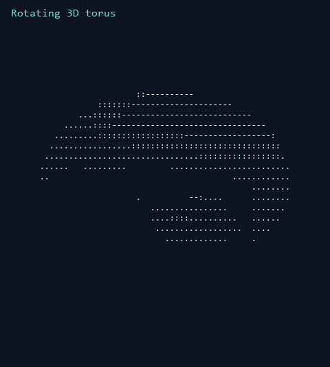
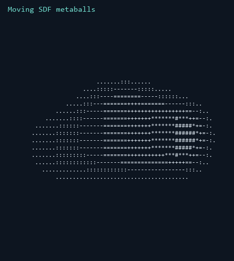
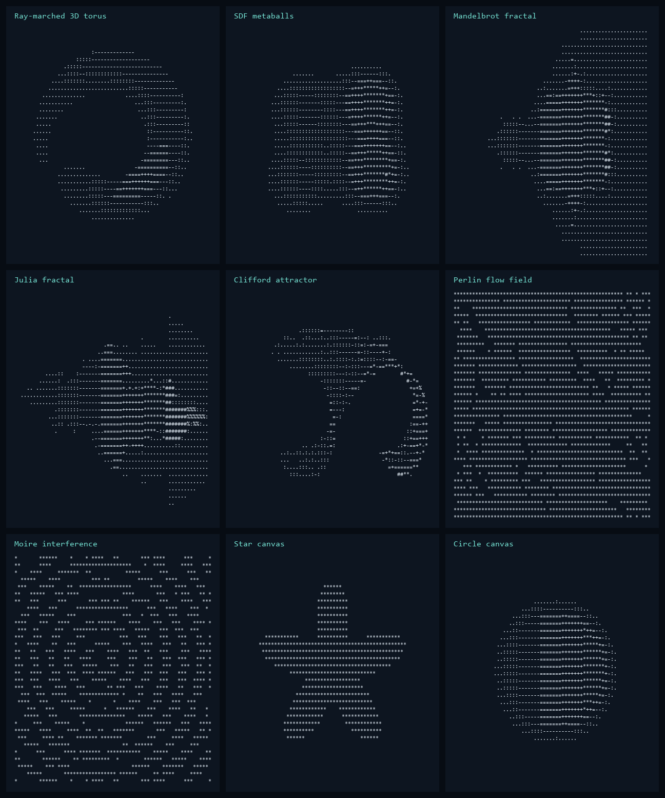
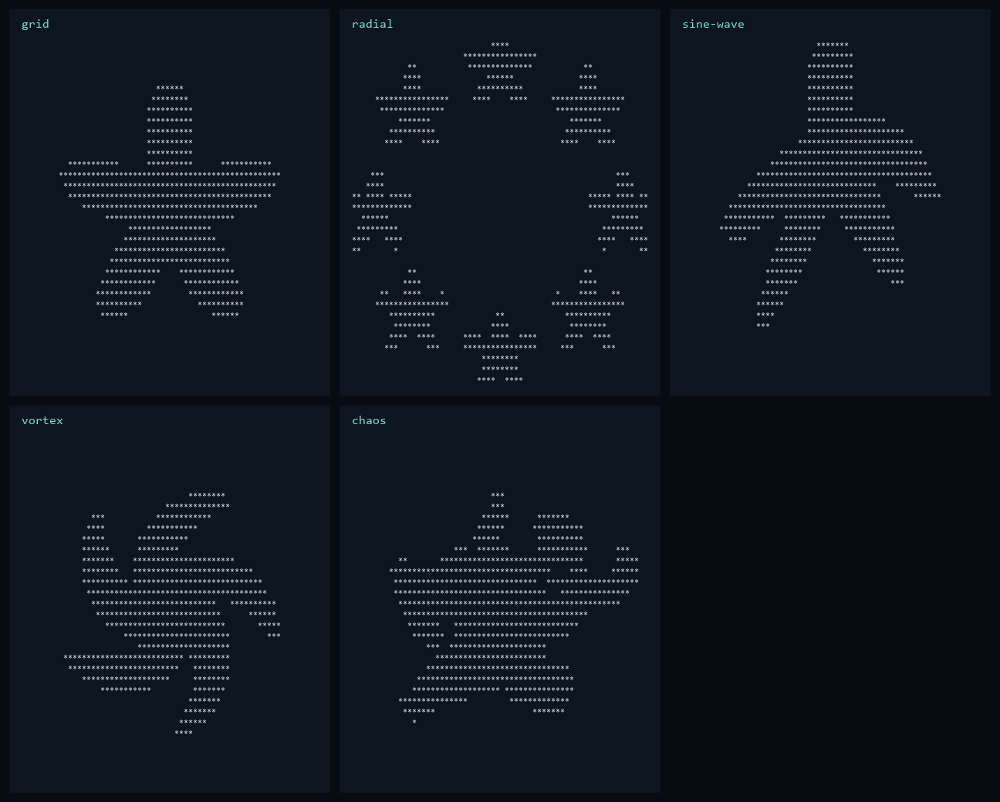
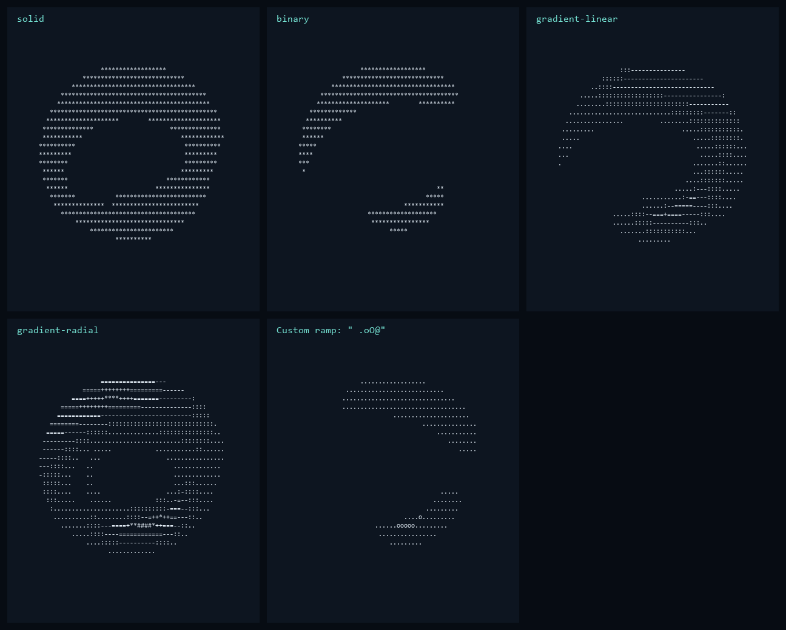
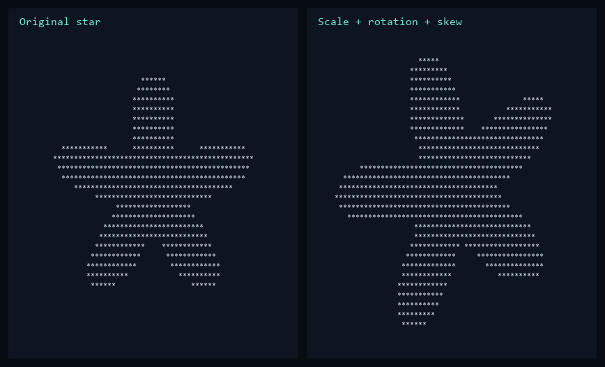
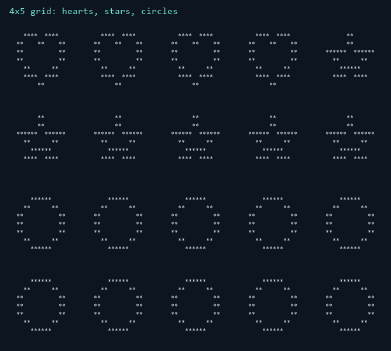
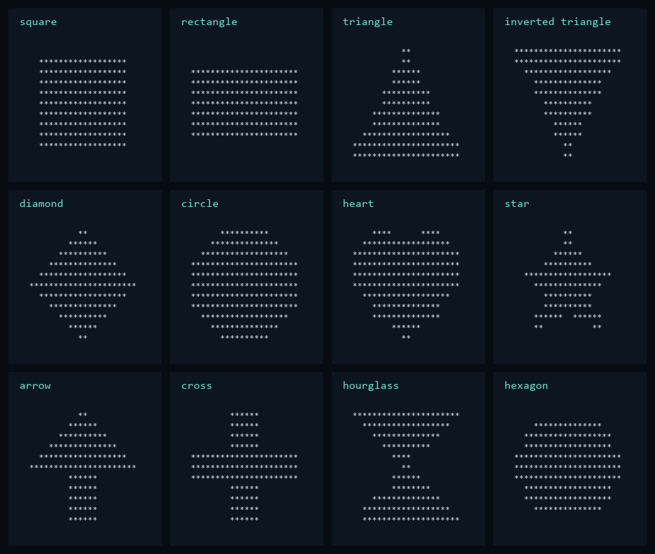
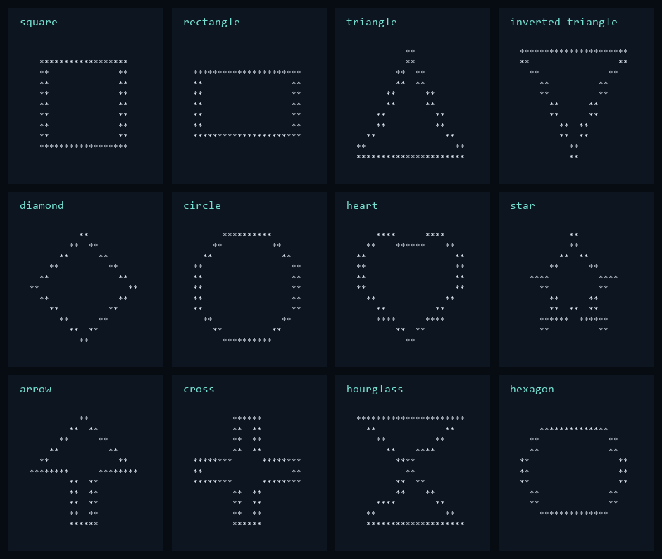

Creating insanely cool art with asterixs
======================================

C++ turns geometric masks, signed distance fields, fractal iterations and Perlin noise into character canvases. The torus uses perspective rays, surface normals and soft shadows. Python handles the controls, saved settings and frame-by-frame animation. Basic shapes use two characters per pixel; mathematical canvases compensate for terminal character proportions.

Install Python 3.10+ and a C++17-capable `g++`, then run `python -m artlab`. On Windows, put the MSYS2 UCRT64 compiler on PATH. The first render builds the native executable; later renders reuse it until the source changes.

The rotating torus is ray-marched and lit from the side.



Four moving distance fields blend into a single changing surface.



Torus, metaballs, Mandelbrot and Julia sets, a Clifford attractor, Perlin flow, moire interference, and circle and star fields.



Repeat shapes in a grid, arrange them radially, or bend the coordinates into a sine wave, vortex or noise field.



Solid asterisks, a binary threshold, linear and radial gradients, and a custom character ramp.



Scale, rotate and skew the canvas together.



A 4x5 grid with four hearts, six stars and ten circles, in that order.



All twelve basic shapes, filled and outlined.





Try these from the project directory:

```sh
python -m artlab shapes
python -m artlab render --grid 4x5 --shapes heart:4,star:6,circle:10 --style outline
python -m artlab render --grid 2x2 --sequence star,heart,circle,diamond --size 17
python -m artlab math --shape donut --shading gradient-linear --frames 120 --fps 12
python -m artlab math --shape metaball --matrix vortex --resolution 120 40 --transform 1.1 25 .2 -.1
python -m artlab math --shape julia --time 2 --ramp " .oO@" --shading gradient-radial
python -m artlab math --shape wave --seed 42 --output flow.txt --write-recipe flow.json
python -m artlab render --recipe flow.json
```

Use `--shuffle --seed 42` for repeatable classic layouts. A sequence can contain `_` for a blank cell. `--output` saves text; with `--frames` it saves each frame separated by a blank line. Run animation without `--output` in a terminal for live playback. `python -m artlab render --help` lists the controls and their defaults.

Individual [previews, terminal output and JSON settings](docs/examples/) are kept together. The [manifest](docs/examples/manifest.json) links each sample to its files; the animation settings record every frame. Replay any static sample with `python -m artlab render --recipe docs/examples/math-donut.json`.

To regenerate the images, install Pillow with `python -m pip install Pillow`, then run `python tools/render_examples.py`. Consolas or DejaVu Sans Mono is required. To write a separate gallery, pass `--output-dir previews`. Run the rendering, input and saved-settings checks with `python -m unittest discover -s tests -v`.
